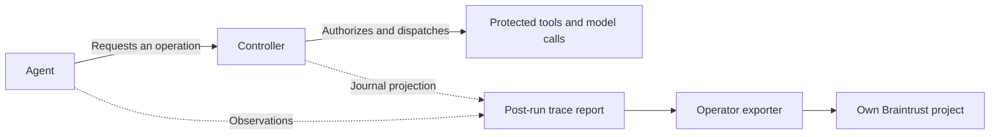

# Optional Braintrust trace export

The operator can inspect the agent's observations and the controller's decisions
in a Braintrust project. This is a post-run, file-based adapter for the local
contract demonstration. It does not change permissions, execute tools, activate
policies, reconcile budgets or recover controller state.

The controller journal remains the authority for controller decisions. Agent
observations retain their `agent_reported_diagnostic` label. A Braintrust view
helps an operator inspect that evidence; it does not grant authority or prove an
external effect occurred.

Here, a protected operation can be an AWS tool call, such as an S3 read, or a
model request routed through the controller's OpenAI broker. The Agents SDK runs
the agent's loop; its local callbacks are observations. Enforcement depends on
routing protected requests through the controller and preventing direct access
with provider credentials, AWS permissions or unrestricted tools.



## Try it without credentials or network access

After following the repository's installation instructions, generate the
fictional report:

```bash
.venv/bin/python -m demo.observe
```

The command prints the path to `contract-report.json` under
`.runtime/observability-demo/run-.../`. Use that exact path below, replacing
`PATH_TO_CONTRACT_REPORT`. The UUID in this example is a fictional project ID;
dry run does not contact Braintrust or check whether that project exists.

```bash
.venv/bin/python -m integration.braintrust_export \
  --report PATH_TO_CONTRACT_REPORT \
  --project-id 00000000-0000-0000-0000-000000000001
```

The default is an offline dry run: the projected payload goes to stdout without
reading an API key or making a network request. The adapter uses Python's
standard library; no Braintrust SDK dependency is required. To save a preview,
add an output path under an existing private runtime directory:

```bash
.venv/bin/python -m integration.braintrust_export \
  --report PATH_TO_CONTRACT_REPORT \
  --project-id 00000000-0000-0000-0000-000000000001 \
  --output .runtime/braintrust-preview.json
```

Runtime artifacts belong outside Git. `--output` creates a new file with mode
`0600`; it rejects an existing file or leaf symlink and does not create parent
directories. Use a new filename for each preview.

## What the export contains

The adapter projects the report through its own fixed field and value
allowlists. It does not upload the entire report. The export contains source
labels, event names, safe status/reason codes, source-local timing and ordering,
run/operation hashes, policy/configuration pins and controller authority
bindings. The collector computes its span hierarchy and UUID5 row IDs from the
sanitized snapshot digest and selected identifiers. Input trace fields cannot
choose a remote parent span or project.

Operations join using **run-ID hash plus operation-ID hash**. Reused operation
names in another run remain separate. Each source retains its own order;
timestamps from separate processes do not establish a precise combined
execution timeline. Stable row IDs identify the same projected evidence on a
subsequent explicit export.

Prompts, model responses, raw tool arguments/results, record contents, assigned
scope descriptions, capabilities, credentials and raw receipts are excluded.
Hashes and policy pins can still link records across views: treat exported
metadata as private operational information, rather than anonymous data.

The adapter produces four deterministic evidence-consistency checks:

| Check | Evidence examined |
|---|---|
| `trace_correlation` | Agent and controller operation correlation |
| `allowed_path_observed` | Recorded allowed decision and protected execution path |
| `denied_dispatch_consistency` | Denied decision and recorded dispatch consistency |
| `policy_binding_consistency` | Configuration, policy and authority bindings |

Missing, truncated or mismatched binding evidence is **inconclusive**. These
checks do not prove effect absence or record integrity. No LLM judge or paid
model call is used. Stop, restart and unknown runtime paths remain covered by
existing controller tests; they are not new Braintrust evaluations.

A file can be modified by whoever controls its filesystem. This adapter does
not authenticate the origin of a report or turn an imported report into a
trusted controller journal. The demonstration's independent effect-journal
checks remain separate evidence.

## Explicitly send from the trusted operator environment

Each operator supplies their own Braintrust account, project and API key, and
pays their own account's charges. Inspect the offline preview first. Supply
`BRAINTRUST_API_KEY` through your trusted operator environment's secret-injection
mechanism, then substitute the real Braintrust project UUID:

```bash
.venv/bin/python -m integration.braintrust_export \
  --report PATH_TO_CONTRACT_REPORT \
  --project-id YOUR_BRAINTRUST_PROJECT_UUID \
  --send
```

Only `--send` reads the key and attempts an upload. The API key belongs to the
trusted exporter/operator identity. Never give it to the agent, add it to a
worker's environment, put it on the command line, or commit it to the
repository. Restrict the key's access to the intended project using the
capabilities available in your Braintrust installation.

The exporter reads only regular report files, at most 256 KiB. The projected
batch is limited to 256 KiB and 384 rows. Upload uses fixed
`https://api.braintrust.dev`, verified TLS, no redirects and one HTTP attempt
with no automatic retry. It has a 5-second socket timeout and a 15-second
deadline enforced by a separate process. It does not print the key, response
contents or untrusted exception text.

A deadline or ambiguous response means delivery is **unknown**: Braintrust may
already have ingested the request. Stable row IDs support an explicit exact
replay of the same payload, but do not establish exactly-once delivery. Inspect
the destination before choosing whether to export again. Upload outcomes leave
controller enforcement, local outcomes and budget accounting unchanged, and
never rerun the agent or protected action.

An accepted upload should be followed by a check in your Braintrust project:
confirm the source labels, matching operation group, one permitted protected
execution and the denied operation's evidence. An HTTP acceptance response by
itself does not demonstrate long-term retention or an immutable audit archive.

## Deployment boundary

This feature exports a completed local demonstration report. It does not enable
automatic Agents SDK remote tracing, stream live events, deploy an AWS
collector, configure CloudWatch retention or establish native AWS runtime
acceptance. Existing global and per-run SDK remote tracing stays disabled.
The exporter must be invoked separately by a trusted operator.

A future AWS deployment can inject the key from AWS Secrets Manager into a
dedicated exporter role after reviewing its IAM and network configuration.
This repository does not provision that role or secret. No new shared hosted
service, publisher-funded allowance or cross-user AWS account is introduced.

See [observability](OBSERVABILITY.md) for the evidence model and
[self-hosting](SELF_HOSTING.md) for the installation boundary. The transport
format follows Braintrust's [project-log insert API](https://www.braintrust.dev/docs/api-reference/logs/insert-project-logs-events)
and its [OpenAPI specification pinned at `161c77c`](https://github.com/braintrustdata/braintrust-openapi/blob/161c77c73c0bc65ef3f4bb9cbd7f9f7deaa9fe23/openapi/spec.json).
The local dry run and offline tests do not validate live ingestion.
